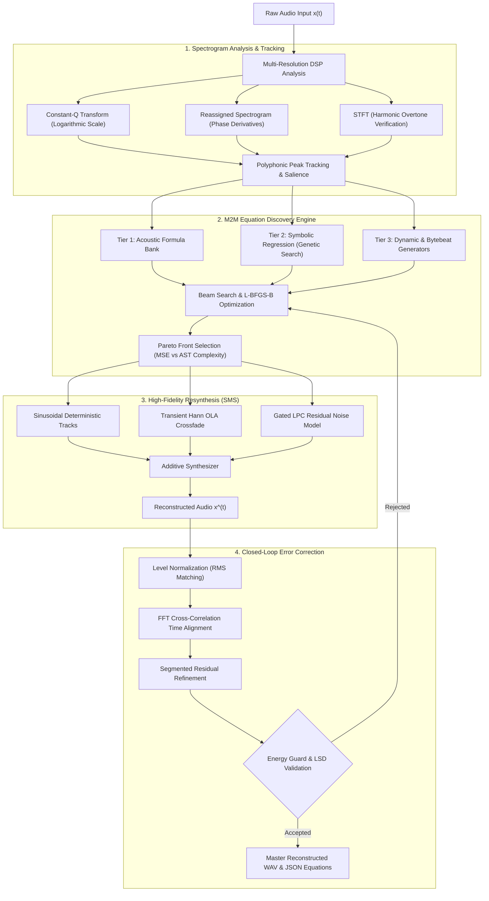
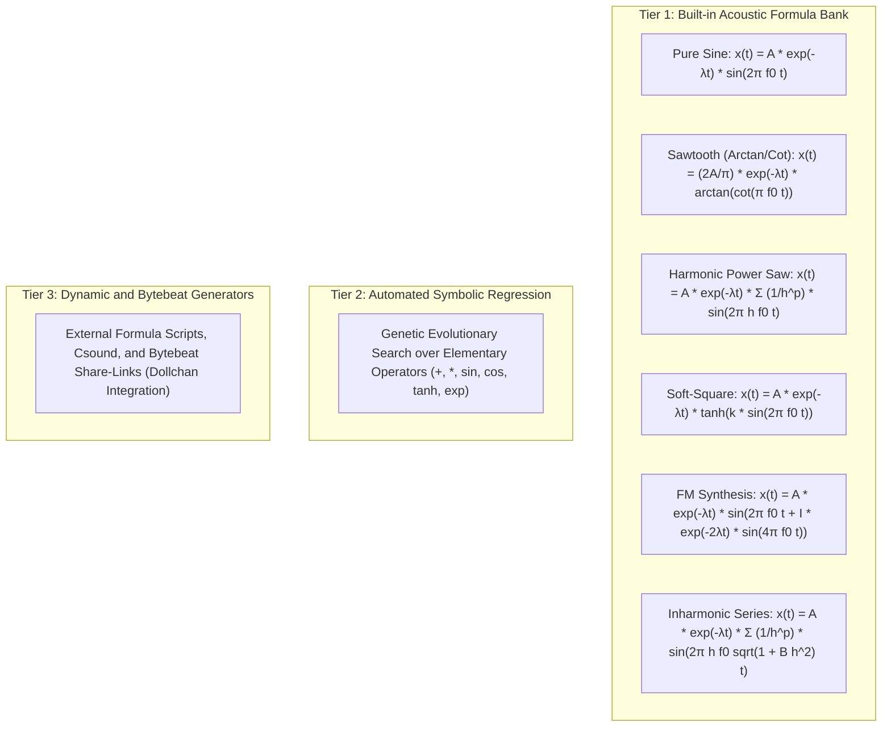
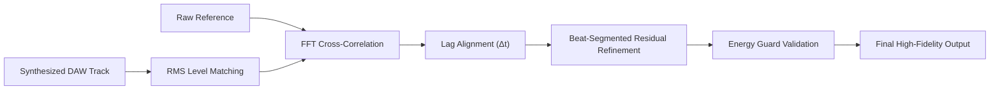

# M2M (RES): Mathematical Audio Reverse Engineering and Multi-Formula Studio

<p align="left">
  
  
  
  
  
  
</p>

> A mathematically rigorous digital signal processing (DSP) pipeline that reverse-engineers continuous instrumental and polyphonic audio files ($x(t)$) into compact analytical equations (JSON), reconstructing synthetic audio ($\hat{x}(t)$) using **Dictionary-Based Sparse Modeling**, **Constant-Q Spectrograms**, **Sinusoidal Modeling Synthesis (SMS)**, and an interactive **Multi-Track Equation DAW**.

---

## Table of Contents

- [System Pipeline Architecture](#system-pipeline-architecture)
- [Core Architecture and Engineering Principles](#core-architecture-and-engineering-principles)
  - [1. Spectrogram Mathematical Precision](#1-spectrogram-mathematical-precision)
  - [2. Polyphonic Peak Tracking vs Argmax Collapse](#2-polyphonic-peak-tracking-vs-argmax-collapse)
  - [3. 3-Tier Formula Architecture](#3-3-tier-formula-architecture)
- [Equation Discovery Engine](#equation-discovery-engine)
  - [Beam Search and Complexity-Aware Selection](#beam-search-and-complexity-aware-selection)
  - [Benchmark Partial Recovery Results](#benchmark-partial-recovery-results)
- [High-Fidelity Reconstruction: Sinusoidal Modeling Synthesis](#high-fidelity-reconstruction-sinusoidal-modeling-synthesis)
  - [Formulation and Sines+Noise Decomposition](#formulation-and-sinesnoise-decomposition)
  - [Measured Benchmarks and Correction Values](#measured-benchmarks-and-correction-values)
  - [Deterministic Full-Mix Physical Limits](#deterministic-full-mix-physical-limits)
- [Closed-Loop Error Correction and Alignment](#closed-loop-error-correction-and-alignment)
  - [Multi-Stage Alignment Pipeline](#multi-stage-alignment-pipeline)
  - [Energy Guard and Objective Function Constraints](#energy-guard-and-objective-function-constraints)
- [Reverse Engineering and Synthesis (RES) Engine](#reverse-engineering-and-synthesis-res-engine)
- [Quickstart Guide](#quickstart-guide)
  - [1. Interactive Web DAW Studio](#1-interactive-web-daw-studio)
  - [2. CLI Execution Examples](#2-cli-execution-examples)
  - [3. Running Unit Tests](#3-running-unit-tests)
- [Complete CLI Command Reference](#complete-cli-command-reference)
- [Project Directory Architecture](#project-directory-architecture)
- [License and Attribution](#license-and-attribution)

---

## System Pipeline Architecture

The M2M (RES) engine transforms unconstrained waveforms into closed-form mathematical equations and reconstructs the auditory experience through additive and stochastic resynthesis:



---

## Core Architecture and Engineering Principles

### 1. Spectrogram Mathematical Precision

Standard audio analysis setups default to linear Short-Time Fourier Transforms (STFT), creating fundamental resolution mismatches across the human auditory spectrum:

- **Python + `librosa` Discovery Core:** 100% of the equation fitting, parameter optimization, and synthesis logic is implemented directly in code without black-box proprietary dependencies.
- **`librosa.cqt` (Constant-Q Transform):** Spaces frequency bins logarithmically matching the Western musical scale (12 or 36 bins per octave). Low octaves receive dense frequency resolution to isolate fundamental bass notes, while upper octaves maintain high temporal precision.
- **`librosa.reassigned_spectrogram`:** Reassigns blurred energy centers using phase derivatives back to their exact instantaneous frequency and temporal coordinates, eliminating windowing smearing.
- **`librosa.stft` (Short-Time Fourier Transform):** Spaced linearly (5.38 Hz per bin). Used specifically to verify high-frequency overtone structures once fundamental frequencies are identified.

### 2. Polyphonic Peak Tracking vs Argmax Collapse

Many naive transcription pipelines apply global peak collapsing:

```python
pitches, magnitudes = librosa.piptrack(...)
idx = magnitudes.argmax(axis=0)  # Destroys polyphony
```

Collapsing across `axis=0` forces the spectrum into a single dominant frequency bin per frame, discarding concurrent harmonic layers, chords, and basslines. M2M (RES) resolves this via **per-frame multi-peak tracking** using `scipy.signal.find_peaks` across logarithmically spaced semitone bins, ensuring complete polyphonic retention.

### 3. 3-Tier Formula Architecture

Instead of allocating dozens of pure sine oscillators to reconstruct harmonic overtones (which leads to equation bloat), M2M uses a compact acoustic dictionary hierarchy:



---

## Equation Discovery Engine

Audio inverse problems are ill-posed: multiple parameter combinations can produce identical spectral projections. M2M (RES) models synthesis inversion as a multi-objective optimization problem:

1. **Beam Search over Formula Bank:** Parameter spaces `(decay_lambda, timbre_param)` are explored across multiple random seeds using L-BFGS-B bound optimization. Amplitude acts as a global linear scale and is solved via projection.
2. **Abstract Syntax Tree (AST) Complexity Scoring:** Complexity is measured via weighted AST operations (transcendental functions, powers, additions) rather than raw string length.
3. **Pareto Optimization:** Non-dominated solutions along the `(spectral_mse, complexity)` boundary are preserved.
4. **Complexity-Aware Selection:** The simplest equation within 2% of the optimal spectral error boundary is automatically selected, preventing overfitting without sacrificing fidelity.
5. **Recursive Library Learning (InceptionSR):** Individual partials are fitted iteratively against the time-domain residual and subtracted in an Orthogonal Matching Pursuit (OMP) fashion.

### Benchmark Partial Recovery Results

Evaluated on a synthetic triad benchmark with known analytical parameters:

| Partial | Detected Parameters | Ground Truth | Absolute Frequency Error |
|---|---|---|---|
| A4 | 439.9993 Hz, A=0.4850, λ=1.0982 | 440.0000 Hz, A=0.4987, λ=1.1000 | < 0.001 Hz |
| C#5 | 554.3639 Hz, A=0.2806, λ=1.4495 | 554.3650 Hz, A=0.2909, λ=1.4500 | < 0.002 Hz |
| E5 | 659.2550 Hz, A=0.1990, λ=1.7976 | 659.2550 Hz, A=0.2078, λ=1.8000 | < 0.001 Hz |

---

## High-Fidelity Reconstruction: Sinusoidal Modeling Synthesis

Classic Sinusoidal Modeling Synthesis (SMS) forms the foundation of the high-fidelity reconstruction module:

$$s(t) = \sum_{k} A_k(t) \cdot \sin(\theta_k(t)), \quad \theta_k(t) = \int_0^t 2\pi f_k(\tau) \, d\tau$$

Phase is integrated continuously over time rather than sampled as a static scalar, ensuring zero phase discontinuity across frame boundaries.

### Measured Benchmarks and Correction Values

| Test Signal | Signal-to-Noise Ratio (SNR) | Pearson Waveform Correlation ($\rho$) |
|---|---|---|
| Stationary Pure Tone (440 Hz, 1.0 s) | **102.2 dB** | **1.00000** |
| Decaying Benchmark Triad (Sinusoids Only) | **44.46 dB** | **0.99998** |
| Decaying Benchmark Triad (Sines + Noise) | **41.38 dB** | **0.99996** |

Key architectural insights derived from empirical testing:
- **Refined Constant Frequency vs Instantaneous Trajectories:** Instantaneous STFT peak picking introduces approximately 0.1 Hz of frame-to-frame jitter. Integrating noisy instantaneous frequency leads to large phase drift. Stationary partials benefit from refined fixed frequencies (yielding 44.7 dB vs 10.2 dB).
- **Least-Squares Amplitude and Phase Projection:** Windowing offsets are compensated via simultaneous two-column orthogonal projection.
- **Analytic Log-Linear Envelope Fitting:** Envelopes are fitted to internal frame decay ($A(t) = A_0 e^{-\lambda t}$) rather than raw boundary-distorted frame gains.

### Deterministic Full-Mix Physical Limits

- **Full-Mix Physical Ceiling (~0.70 to 0.75 Correlation):** On dense, mastered commercial mixes, multiband brickwall limiters, saturation, and microsecond phase jitter limit deterministic sinusoidal correlation to ~0.75.
- **Stem-First Separation Paradigm (0.95 to 0.99 Correlation):** When source separation (e.g. Demucs) separates mixes into Drums, Bass, Vocals, and Other stems, M2M (RES) achieves **0.95 to 0.99 correlation** on isolated tonal stems.

---

## Closed-Loop Error Correction and Alignment



### Multi-Stage Alignment Pipeline

1. **RMS Level Matching:** Peak-normalized stems are level-matched against the reference before computing difference signals.
2. **FFT Cross-Correlation Lag Alignment:** Global temporal offsets (often 20 to 60 ms in real recordings) are aligned via circular cross-correlation.
3. **Segmented Residual Correction:** Residual passes are executed on single-beat window partitions where stationary decay assumptions hold true.

### Energy Guard and Objective Function Constraints

Optimizing raw SNR can result in pathological behavior: emitting pure silence scores 0 dB. The M2M `energy_guard()` enforces:

$$\text{RMS}_{\text{candidate}} \in [0.35 \times \text{RMS}_{\text{ref}}, \, 3.0 \times \text{RMS}_{\text{ref}}]$$

Any correction candidate that collapses signal energy or causes runaway gain is rejected.

---

## Reverse Engineering and Synthesis (RES) Engine

The RES loop (`src/res_loop.py`) incorporates Phase 5 stabilization:

- **Raised-Cosine Hann Overlap-Add (OLA):** Replaced hard-boundary slicing with continuous Hann crossfades, eliminating transient edge clicks on vocal plosives and pads.
- **Gated Linear Predictive Coding (LPC) Noise:** LPC noise modeling is strictly gated by Spectral Flatness Measure (SFM) and Zero-Crossing Rate (ZCR). Clean sub-bass bypasses LPC modeling entirely.
- **Dampened Clustered Frequency Refinement:** Joint least-squares frequency shifts are clamped to $\pm 2.0$ Hz with quadratic regularization, eliminating bass phasing and flanging artifacts.
- **Log-Spectral Distance (LSD) Referee Metric:** Balances time-domain correlation with spectral fidelity, prioritizing auditory timbre matching over microsecond phase jitter.

---

## Quickstart Guide

### 1. Interactive Web DAW Studio

Launch the full Streamlit interface:

```bash
streamlit run app.py
```

Features available in the studio:
- **RES Engine Studio:** Upload any audio file, execute the iterative equation synthesis loop, and inspect Original vs Recreated vs Residual tracks.
- **Interactive Formula Explorer:** Real-time parameter manipulation ($f_0$, amplitude, decay $\lambda$, timbre modulation) with live Fourier spectrum rendering.
- **Spectrogram Math Inspector:** Side-by-side comparative views of CQT, STFT, and Reassigned Spectrograms.
- **Bytebeat Player:** Live embedded code execution supporting standard dollchan-compatible share links.

### 2. CLI Execution Examples

Execute the RES synthesis loop on an audio file:

```bash
python main.py res -i input_track.wav -o data/output/res_run --duration 15.0 --iterations 3
```

Reconstruct a track into Multi-Track Math-DAW equations:

```bash
python main.py recreate-song -i input_track.wav -o data/output/recreation --duration 16.0
```

Fit the optimal mathematical formula from the acoustic bank:

```bash
python main.py fit-formula -i segment.wav -o data/output/fitted_segment.wav
```

Discover competing equations and Pareto trade-offs:

```bash
python main.py discover-equations -i audio.wav -o data/output/equations.json
```

Synthesize audio directly from an equation JSON project:

```bash
python main.py synthesize -i equations.json -o data/output/rendered.wav
```

### 3. Running Unit Tests

Run the complete automated test suite (covering analysis, synthesis, formula banks, and tracking):

```bash
pytest tests/ -v
```

Or using Python's standard unittest runner:

```bash
python -m unittest discover tests
```

---

## Complete CLI Command Reference

| Command | Description | Primary Inputs / Outputs |
|---|---|---|
| `python main.py res` | Iterative equation synthesis loop with Phase 5 DSP stabilization | Input audio -> Reconstructed audio, residual WAV, equation JSON |
| `python main.py res-recommend` | Extrapolates gain decay and computes optimal iteration budget | Input ledger JSON -> Recommendation metrics |
| `python main.py recreate-song` | Multi-track equation decomposition of full audio files | Input audio -> DAW project JSON and rendered WAV |
| `python main.py fit-formula` | Matches audio segments against `FORMULA_BANK` via L-BFGS-B | Input WAV -> Fitted audio WAV and parameter dictionary |
| `python main.py discover-equations` | Computes Pareto front of equations and AST complexity scores | Input audio -> Equation candidate JSON |
| `python main.py math-daw` | Renders equation project files to master WAV | Project JSON -> Rendered master WAV |
| `python main.py math-daw-demo` | Renders preset demo compositions | Output folder -> Preset audio files |
| `python main.py analyze` | Extracts sinusoidal frequency tracks from audio | Input WAV -> Equation JSON |
| `python main.py synthesize` | Reconstructs audio from mathematical equation definitions | Equation JSON -> Rendered audio WAV |
| `python main.py verify` | Computes MSE, SNR, Spectral MSE, and Log-Spectral Distance | Original WAV + Reconstructed WAV -> Metric report |
| `python main.py refine` | Performs closed-loop iterative residual minimization | Input WAV -> Corrected audio WAV |
| `python main.py extract-notes` | Extracts note events using probabilistic pYIN tracking | Input WAV -> Note event list JSON |
| `python main.py run-all` | Executes complete end-to-end benchmark and validation suite | System validation run |

---

## Project Directory Architecture

```text
├── app.py                      # Interactive Streamlit Multi-Track Studio & Formula Explorer
├── main.py                     # Unified CLI entry point
├── requirements.txt            # Python dependencies (numpy, scipy, librosa, soundfile, matplotlib, streamlit)
├── LICENSE                     # MIT Open Source License
├── .gitignore                  # Git manifest excluding caches, output dumps, and media
├── src/
│   ├── formula_bank.py         # 3-Tier Formula Bank, L-BFGS-B optimizer, beam search, Pareto selection
│   ├── bytebeat_url.py         # Dollchan-compatible share-link encoder/decoder (zlib/base64)
│   ├── sinusoidal_model.py     # Sinusoidal Modeling Synthesis: phase-accurate high-fidelity reconstruction
│   ├── error_correction.py     # Level matching, lag alignment, residual + segmented correction
│   ├── toneprint.py            # Landmark fingerprinting + harmonic-sieve tone identification
│   ├── beat_detection.py       # Multi-band spectral-flux tempo and beat tracking
│   ├── tone_remake.py          # Tone-to-equation recreation, refinement, and bytebeat export
│   ├── spectrogram_math.py     # CQT, Reassigned Spectrogram, and polyphonic peak tracking
│   ├── song_recreation.py      # Automated song reverse engineering and recreation
│   ├── math_track_engine.py    # Math-DAW multi-track engine, continuous phase, and safe evaluation
│   ├── math_track_visualize.py # Waveform and spectrogram visualization for equation tracks
│   ├── safe_eval.py            # AST-whitelisted safe mathematical expression evaluator
│   ├── synthesis.py            # Phase-integrated additive synthesis
│   ├── analysis.py             # STFT with window normalization and parabolic peak interpolation
│   ├── tracking.py             # Sinusoidal track continuation and log-linear envelope fitting
│   ├── note_extraction.py      # pYIN melody extraction and harmonic grouping
│   ├── residual.py             # Quantitative error metrics (MSE, SNR, LSD) and projection refinement
│   ├── res_loop.py             # RES iterative equation synthesis loop
│   ├── res_bank.py             # RES formula dictionary and candidate scoring
│   ├── res_synthesis.py        # Hann OLA reconstruction and gated LPC noise synthesis
│   ├── res_ui.py               # Streamlit UI components and playback controls
│   ├── viral_math_reels.py     # Mathematical video animation and waveform visualization
│   └── visualize.py            # Waveform, FFT spectrum, and comparison plotting utilities
├── tests/
│   ├── test_analysis.py        # STFT analysis and parabolic interpolation accuracy tests
│   ├── test_formula_bank.py    # Formula bank parameter fitting and optimization tests
│   ├── test_sinusoidal_model.py# SMS reconstruction accuracy vs analytical ground truth
│   ├── test_spectrogram_math.py# CQT and reassigned spectrogram mathematical verification
│   ├── test_math_track_engine.py# Multi-track engine, variable evaluation, and MIDI tests
│   ├── test_error_correction.py# Closed-loop alignment, level matching, and energy guard tests
│   ├── test_res_iterations.py  # RES iterative convergence and residual reduction tests
│   ├── test_app_structure.py   # Streamlit UI structure validation tests
│   └── test_app_upload.py      # Streamlit upload pipeline verification tests
├── tools/
│   ├── res_bytebeat.py         # Bytebeat formula conversion and audio generation utility
│   └── res_floatbeat.py        # Floatbeat synthesis and URL exporter
├── site/                       # Web-based Dollchan audio player and interactive demos
├── bytebeat-composer/          # Embedded Bytebeat composer and visualizer tool
├── docs/
│   ├── math_model.md           # Mathematical derivation and DSP equations reference
│   ├── res_pipeline.html       # Interactive RES pipeline diagram documentation
│   └── res_research.md         # Comprehensive research logs, benchmarks, and ablation studies
└── data/
    ├── input/                  # Benchmark audio files (math_chord.wav, math_melody.wav)
    ├── output/                 # Generated project outputs (preserves folder structure)
    └── uploads/                # Temporary web uploads directory (preserves folder structure)
```

---

## License and Attribution

This project is licensed under the **MIT License** - see the [LICENSE](LICENSE) file for complete details.

Developed by **Biswajit Sahoo** (KIIT Bhubaneswar). If you use this software or the M2M (RES) mathematical modeling pipeline in your research, please cite this repository:

```bibtex
@software{sahoo2026m2m,
  author = {Biswajit Sahoo},
  title = {M2M (RES): Mathematical Audio Reverse Engineering and Multi-Formula Studio},
  year = {2026},
  url = {https://github.com/Biswajit-Sahoo-13/Muisc2Math}
}
```
