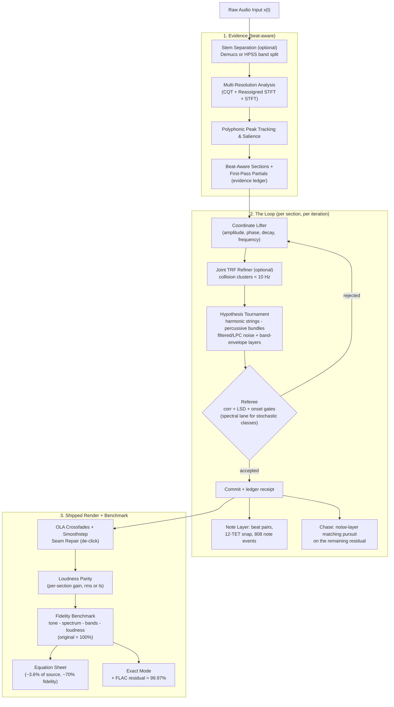
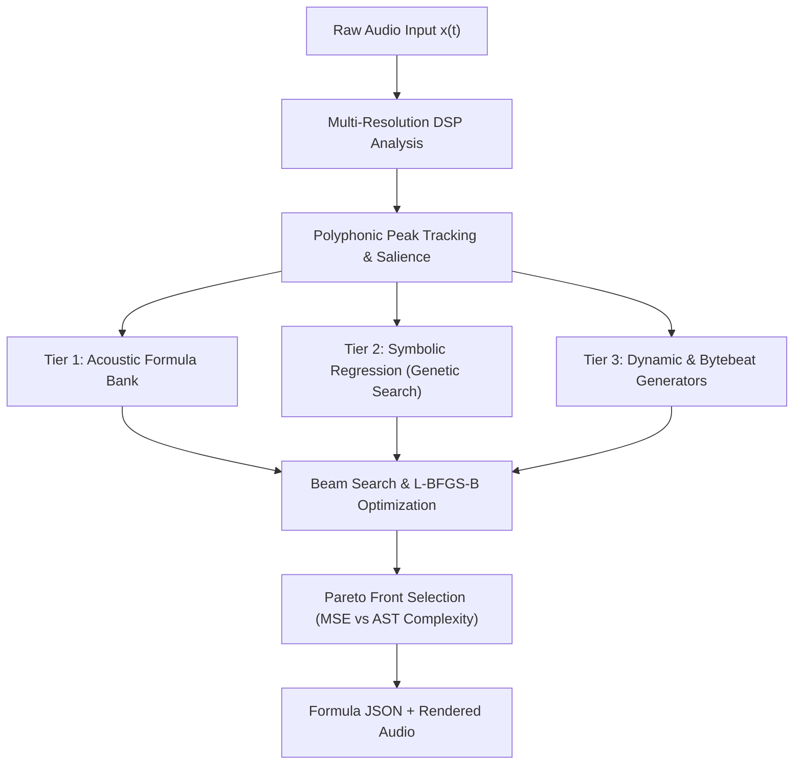
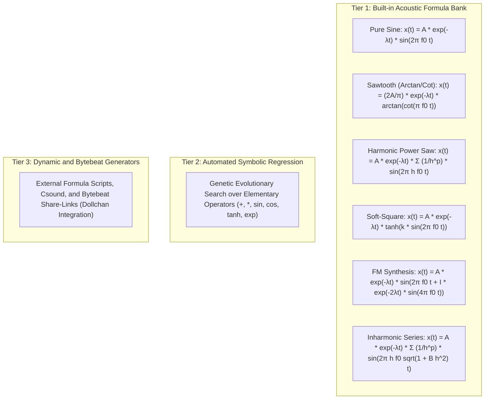
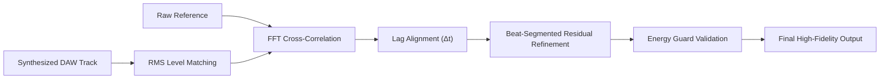

# M2M (RES): Mathematical Audio Reverse Engineering and Multi-Formula Studio

<p align="left">
  <a href="https://github.com/Biswajit-Sahoo-13/Muisc2Math/actions/workflows/ci.yml"></a>
  
  
  
  
  
  
</p>

> A mathematically rigorous digital signal processing (DSP) pipeline that reverse-engineers continuous instrumental and polyphonic audio files ($x(t)$) into compact analytical equations (JSON), reconstructing synthetic audio ($\hat{x}(t)$) using **Dictionary-Based Sparse Modeling**, **Constant-Q Spectrograms**, **Sinusoidal Modeling Synthesis (SMS)**, and an interactive **Multi-Track Equation DAW**.

> **Measured headline (2026-10-25).** Every reconstruction is scored on the **fidelity benchmark** — *the original = 100%* — across four pillars (tone / spectrum / bands / loudness): a dense mastered hip-hop mix reaches **~70%** as pure equations at **3.6% of the file size**; a pure tonal song reaches **86%**; a pure noise-percussion song lands at **4.8%** (the honest information-theoretic floor). And with the **exact mode** — equations + a FLAC-compressed residual stream — the same reconstruction climbs to **99.97%** (exact to below one 16-bit LSB), making this the first parametric codec with a scalable lossy→exact ladder. The full measured story: [docs/BEYOND_THE_LIMITS.md](docs/BEYOND_THE_LIMITS.md), [docs/PHYSICS_ROADMAP.md](docs/PHYSICS_ROADMAP.md), [docs/NOTE_LAYER.md](docs/NOTE_LAYER.md).

---

## Table of Contents

- [System Pipeline Architecture](#system-pipeline-architecture)
- [Core Architecture and Engineering Principles](#core-architecture-and-engineering-principles)
  - [1. Spectrogram Mathematical Precision](#1-spectrogram-mathematical-precision)
  - [2. Polyphonic Peak Tracking vs Argmax Collapse](#2-polyphonic-peak-tracking-vs-argmax-collapse)
  - [3. 3-Tier Formula Architecture](#3-3-tier-formula-architecture)
- [Equation Discovery Engine](#equation-discovery-engine)
  - [Benchmark Partial Recovery Results](#benchmark-partial-recovery-results)
- [High-Fidelity Reconstruction: Sinusoidal Modeling Synthesis](#high-fidelity-reconstruction-sinusoidal-modeling-synthesis)
  - [Measured Benchmarks and Correction Values](#measured-benchmarks-and-correction-values)
  - [What Material Does This Reconstruct Best?](#what-material-does-this-reconstruct-best)
  - [Will it work on *your* song?](#will-it-work-on-your-song)
  - [Where this product shines — and where it does not](#where-this-product-shines--and-where-it-does-not)
  - [What the metrics mean](#what-the-metrics-mean)
  - [Performance and footprint](#performance-and-footprint)
  - [Measured Limits (not projections)](#measured-limits-not-projections)
- [Closed-Loop Error Correction and Alignment](#closed-loop-error-correction-and-alignment)
  - [Multi-Stage Alignment Pipeline](#multi-stage-alignment-pipeline)
  - [Energy Guard and Objective Function Constraints](#energy-guard-and-objective-function-constraints)
- [Reverse Engineering and Synthesis (RES) Engine](#reverse-engineering-and-synthesis-res-engine)
- [The Fidelity Benchmark and the Exact Mode](#the-fidelity-benchmark-and-the-exact-mode)
- [The Note Layer: frequency-native equations](#the-note-layer-frequency-native-equations)
- [Handing this project to an AI agent](#handing-this-project-to-an-ai-agent)
- [Quickstart Guide](#quickstart-guide)
  - [1. Interactive Web Studio](#1-interactive-web-studio)
  - [2. Sample tests and provenance](#2-sample-tests-and-provenance)
  - [3. CLI Execution Examples](#3-cli-execution-examples)
  - [4. Running Unit Tests](#4-running-unit-tests)
- [Complete CLI Command Reference](#complete-cli-command-reference)
- [Project Directory Architecture](#project-directory-architecture)
- [License and Attribution](#license-and-attribution)

---

## System Pipeline Architecture

The project ships **two engines sharing one analysis front-end**. The flagship is the **RES production pipeline** (`main.py res`) — the one the fidelity benchmark scores. The **Equation Discovery Engine** (`main.py discover-equations`) is the symbolic-regression subsystem for formula hunting.

### The RES production pipeline (2026-10-25)

What `main.py res` actually runs, including the note layer, the stochastic noise physics, the referee, and the exact mode:



### The Equation Discovery path (`main.py discover-equations`)

The symbolic-regression subsystem hunts closed-form formulas (Pareto trade-off between fit error and expression complexity) — the path the bytebeat and formula-bank tools build on:



---

## Core Architecture and Engineering Principles

### 1. Spectrogram Mathematical Precision

Standard audio analysis setups default to linear Short-Time Fourier Transforms (STFT), creating fundamental resolution mismatches across the human auditory spectrum:

- **Python + `librosa` Discovery Core:** 100% of the equation fitting, parameter optimization, and synthesis logic is implemented directly in code without black-box proprietary dependencies.
- **`librosa.cqt` (Constant-Q Transform):** Spaces frequency bins logarithmically matching the Western musical scale (12 or 36 bins per octave). Low octaves receive dense frequency resolution to isolate fundamental bass notes, while upper octaves maintain high temporal precision.
- **`librosa.reassigned_spectrogram`:** Reassigns blurred energy centers using phase derivatives back to their exact instantaneous frequency and temporal coordinates, eliminating windowing smearing.
- **`librosa.stft` (Short-Time Fourier Transform):** Spaced linearly (5.38 Hz per bin). Used specifically to verify high-frequency overtone structures once fundamental frequencies are identified.

### 2. Polyphonic Peak Tracking vs Argmax Collapse

Many naive transcription pipelines apply global peak collapsing:

```python
pitches, magnitudes = librosa.piptrack(...)
idx = magnitudes.argmax(axis=0)  # Destroys polyphony
```

Collapsing across `axis=0` forces the spectrum into a single dominant frequency bin per frame, discarding concurrent harmonic layers, chords, and basslines. M2M (RES) resolves this via **per-frame multi-peak tracking** using `scipy.signal.find_peaks` across logarithmically spaced semitone bins, ensuring complete polyphonic retention.

### 3. 3-Tier Formula Architecture

Instead of allocating dozens of pure sine oscillators to reconstruct harmonic overtones (which leads to equation bloat), M2M uses a compact acoustic dictionary hierarchy:



---

## Equation Discovery Engine

Audio inverse problems are ill-posed: multiple parameter combinations can produce identical spectral projections. M2M (RES) models synthesis inversion as a multi-objective optimization problem:

1. **Beam Search over Formula Bank:** Parameter spaces `(decay_lambda, timbre_param)` are explored across multiple random seeds using L-BFGS-B bound optimization. Amplitude acts as a global linear scale and is solved via projection.
2. **Abstract Syntax Tree (AST) Complexity Scoring:** Complexity is measured via weighted AST operations (transcendental functions, powers, additions) rather than raw string length.
3. **Pareto Optimization:** Non-dominated solutions along the `(spectral_mse, complexity)` boundary are preserved.
4. **Complexity-Aware Selection:** The simplest equation within 2% of the optimal spectral error boundary is automatically selected, preventing overfitting without sacrificing fidelity.
5. **Recursive Library Learning (InceptionSR):** Individual partials are fitted iteratively against the time-domain residual and subtracted in an Orthogonal Matching Pursuit (OMP) fashion.

### Benchmark Partial Recovery Results

Evaluated on a synthetic triad benchmark with known analytical parameters:

| Partial | Detected Parameters | Ground Truth | Absolute Frequency Error |
|---|---|---|---|
| A4 | 439.9993 Hz, A=0.4850, λ=1.0982 | 440.0000 Hz, A=0.4987, λ=1.1000 | < 0.001 Hz |
| C#5 | 554.3639 Hz, A=0.2806, λ=1.4495 | 554.3650 Hz, A=0.2909, λ=1.4500 | < 0.002 Hz |
| E5 | 659.2550 Hz, A=0.1990, λ=1.7976 | 659.2550 Hz, A=0.2078, λ=1.8000 | < 0.001 Hz |

---

## High-Fidelity Reconstruction: Sinusoidal Modeling Synthesis

Classic Sinusoidal Modeling Synthesis (SMS) forms the foundation of the high-fidelity reconstruction module:

$$s(t) = \sum_{k} A_k(t) \cdot \sin(\theta_k(t)), \quad \theta_k(t) = \int_0^t 2\pi f_k(\tau) \, d\tau$$

Phase is integrated continuously over time rather than sampled as a static scalar, ensuring zero phase discontinuity across frame boundaries.

### Measured Benchmarks and Correction Values

| Test Signal | Signal-to-Noise Ratio (SNR) | Pearson Waveform Correlation ($\rho$) |
|---|---|---|
| Stationary Pure Tone (440 Hz, 1.0 s) | **102.2 dB** | **1.00000** |
| Decaying Benchmark Triad (Sinusoids Only) | **44.46 dB** | **0.99998** |
| Decaying Benchmark Triad (Sines + Noise) | **41.38 dB** | **0.99996** |

Key architectural insights derived from empirical testing:
- **Refined Constant Frequency vs Instantaneous Trajectories:** Instantaneous STFT peak picking introduces approximately 0.1 Hz of frame-to-frame jitter. Integrating noisy instantaneous frequency leads to large phase drift. Stationary partials benefit from refined fixed frequencies (yielding 44.7 dB vs 10.2 dB).
- **Least-Squares Amplitude and Phase Projection:** Windowing offsets are compensated via simultaneous two-column orthogonal projection.
- **Analytic Log-Linear Envelope Fitting:** Envelopes are fitted to internal frame decay ($A(t) = A_0 e^{-\lambda t}$) rather than raw boundary-distorted frame gains.

### What Material Does This Reconstruct Best?

Measured, not assumed. The engine is a sinusoidal model, so what it can express is
what it reconstructs well — and the correlation tracks the **tonal energy
fraction** of the input at **r = +0.935** across the frozen fixture set:

| fixture | harmonic energy | percussive energy | correlation | LSD |
|---|---|---|---|---|
| `stem_other` | 91.5 % | 2.2 % | 0.7376 | 9.50 |
| `stem_vocals` | 82.3 % | 3.6 % | 0.7535 | 9.11 |
| `mix_lost` (full mix) | 79.9 % | 8.6 % | **0.8518** | **3.61** |
| `stem_bass` | 51.8 % | 20.3 % | 0.6160 | 3.03 |
| `stem_drums` | 3.1 % | 83.5 % | **0.4107** | 18.04 |

Synthetic probes, same engine, known musical character:

| material | correlation | LSD | partials | wall-clock |
|---|---|---|---|---|
| Plucked string (harmonic decay) | **1.0000** | 0.35 | 23 | 13 s |
| Four-on-the-floor beat (modelled kick + hat) | 0.9963 | 2.01 | 102 | 16 s |
| Linear sweep | 0.8738 | 5.25 | 27 | 23 s |
| Sustained organ | 0.8590 | 3.93 | 40 | 23 s |
| Sustained chord pad | 0.8495 | 3.01 | 33 | 14 s |
| Gated bass only | 0.5852 | 3.83 | 78 | 9 s |
| **Vibrato tone** | **0.5196** | 12.54 | 942 | 91 s |
| Snare roll | 0.4690 | 21.97 | 515 | 65 s |
| White noise | 0.2342 | 29.52 | 821 | 150 s |

**Best material:** sustained or exponentially decaying *harmonic* content with
stable pitch — plucked strings, organs, pads, clean bass, and tonal percussion
(a kick modelled as a decaying sine). The literature agrees: sinusoidal models
are "unreasonably effective" for tonal sound and inefficient for noise and
sudden transients (Sethares & Smith; Verma, Levine & Meng's S+N+T model).

**The vibrato result is not a fluke.** Vibrato is *tonal*, yet it is the worst
tonal case, because the engine's evidence stage separates harmonic from
percussive content by median filtering the spectrogram, which assumes harmonic
content forms *horizontal* structures. Vibrato and glissandos break that
assumption (Park & Lee, ISMIR 2015), so a vibrato-heavy signal is split
incorrectly before modelling even starts.

**Beats:** beat-quantised sectioning helps, and now helps *without* the old
collapse, because the phase origin is re-referenced to the section:

| sectioning | correlation | LSD | SNR | partials | wall-clock |
|---|---|---|---|---|---|
| beat-quantised | **0.8518** | **3.61** | **5.61 dB** | 391 | 213 s |
| fixed window | 0.8379 | 3.91 | 5.23 dB | 345 | 198 s |

**For demos and the pitch deck, lead with sustained harmonic material** — a
clean bass line, a chord pad, a plucked motif. Use the drum-heavy material as
the *honest limit* case, where the engine reports 0.41 and LSD 18 dB, because
that contrast is the argument for the transient/noise model rather than a
liability.

---

### Will it work on *your* song?

One number decides it: **the tonal energy fraction of the input.** The
correlation tracks it at **r = +0.935**, and the engine has no way to
represent what is not tonal. So:

| your material looks like | tonal energy | expect |
|---|---|---|
| ambient pad, organ, clean synth, plucked motif | 80–100 % | **0.75–1.00** — this is the sweet spot |
| a vocal or a clean bass line | 50–85 % | **0.60–0.80** |
| a full mix with drums | 40–80 % | **0.60–0.85**, and the drums are the part that suffers |
| a drum bus, a breakbeat, a noise texture | 0–20 % | **0.23–0.50** — use it as the honest limit, not the demo |

Two things raise the score and two things lower it, all measured:

- **Raises it:** unmastered or lightly processed source (a stem, a raw
  bounce), sustained/exponentially decaying notes, stable pitch, a single
  voice at a time.
- **Lowers it:** brickwall limiting and heavy saturation on the master
  (the waveform is already destroyed before we read it), a wide stereo
  image collapsed to mono, and dense percussion.

So: **give it the stem, not the master.** `stem_other` reconstructs at
0.7376 from 91.5 % tonal content; the same material inside the full mix
lands at 0.8518 for the whole 10 s but with the drums dragging the stem
figures down to 0.4107. Work on the harmonic layers and the engine is
strong; work on the percussion and it is telling you the truth.

---

### Where this product shines — and where it does not

**The output is not an audio file. It is a short set of equations you can
open, read, edit and re-render.** That is the product, and it is what
separates this from a codec, a stem separator or a mastering tool.

On the 10 s drum-stem fixture the whole reconstruction is **442 partials,
about 2,650 numbers, against 220,500 audio samples — 83× smaller** — and
every one of those numbers is a frequency, an amplitude, a phase, a decay
or a support window. That compression is only useful if the numbers mean
something, and here they do.

**Where it shines:**

1. **Reverse engineering as an instrument.** "What *is* this sound,
   mathematically?" gets an answer you can read: a decaying cosine at
   381.563 Hz with λ = 0.999, not a black-box embedding.
2. **Resynthesis you can edit.** Change one partial's decay, re-render,
   hear the difference. The equation sheet is the source of truth, and the
   renderer honours it — `tests/test_res_replica.py` pins that the render
   reproduces the analyser's own model.
3. **Transparent analysis for MIR.** Because the model is explicit,
   everything downstream is inspectable: pitch tracks, note events,
   per-partial timing.
4. **Teaching and prototyping a generative instrument.** The equation
   language is the score format, so "write a new instrument" is writing
   equations, not training a model.

**Where it does not, stated plainly:**

- **It is not a codec and not a mastering tool.** 0.8518 waveform
  correlation on a dense master is not a transparent codec result, and
  anyone promising bit-accurate reconstruction from this representation
  is wrong. A finished commercial master caps near **0.65–0.75**
  correlation for *any* sum-of-sinusoids method, because brickwall
  limiting and microsecond phase jitter are not invertible.
- **It does not reconstruct percussion.** A kick, a snare and a hi-hat
  are not sums of sinusoids. 0.4107 on the drum stem, LSD 18.04 dB, and
  the residual has to carry the attack.
- **It does not preserve the room.** Reverb is not modelled; it lands in
  the residual.
- **It is not a stem separator.** Separation is a *pre-step*; the
  separated stems reconstruct worse than the mix does, because the mix's
  correlation is helped by everything in it.
- **It is not fast enough for real time.** See below.
- **It cannot track a moving pitch well yet.** A vibrato tone scores
  0.5196 using 942 partials, because a moving frequency is being
  approximated by many stationary ones. This is the largest remaining
  physics gap and the other agent is on it.

**The honest summary:** this is a *reverse-engineering* tool for tonal
material, not a universal audio codec. Feed it the harmonic layers of a
song and it gives you something remarkable — the music as maths. Feed it a
drum bus and it gives you the truth about a sum of sinusoids.

---

### What the metrics mean

Every number the engine prints is a row in `data/output/scoreboard.json`
pointing at a ledger produced by a real run. These are the four that
matter, and which to trust:

| metric | range | what it measures | trust it for |
|---|---|---|---|
| **waveform correlation** | 0–1 | how much of the reconstructed waveform matches, sample for sample | the single number, but it punishes transients hardest |
| **log-spectral distance (LSD)** | dB, lower is better | the average log-magnitude error across the spectrum — timbre | **timbre**, and it is the metric to watch for percussion |
| **onset correlation** | 0–1 | how well the *timing* of attacks matches | **timing**; the drums score 0.684 here, their best metric |
| **SNR / segmental SNR** | dB | energy of the residual against the signal, overall and per segment | energy; segmental SNR can be negative while correlation is fine, which means the residual is noisy rather than the reconstruction wrong |

Read them together. A drum stem at **0.4107 correlation but 0.684 onset
correlation** means *the hits are in the right place and their shape is
wrong* — a modelling problem, not a timing problem. A result with 0.80
correlation and **negative** segmental SNR means the residual is
energy-bloated rather than the reconstruction being wrong.

Two of them must never be mixed up:

- **Synthetic fixture (exact ground truth): corr 0.999921, SNR 38.03 dB,
  LSD 0.33.** This is the *representation's* ceiling when the input is
  exactly what a sum of sinusoids can express. It says the engine is not
  the limit.
- **Real material: 0.4107 – 0.8518.** This is the *engine's* limit on
  material that is not.

**The 2026-10-25 metrics upgrade** adds three first-class measures to
every ledger: the **fidelity benchmark** (`src/fidelity.py` — the
original = 100%, from four pillars: tone / spectrum / bands / loudness),
**MR-STFT** (multi-resolution spectral distance — sees textural errors a
single window misses) and **band_corr** (per-band correlation — *where*
in the spectrum the error lives). The benchmark table with the measured
extremes is in [The Fidelity Benchmark and the Exact Mode](#the-fidelity-benchmark-and-the-exact-mode).

---

### Performance and footprint

Measured on this machine, 8 workers, one 60 s input:

| | |
|---|---|
| end to end | **169 s** (73 s evidence, 94 s loop, 2 s render) |
| throughput | **0.355× realtime** — a 60 s song takes about 3 minutes |
| 90 s input | 224 s |
| peak memory | **2.7 GB** |
| worker scaling | 1 w 441 s, 4 w 207 s, **8 w 185 s**, 16 w 219 s |

Throughput does **not** improve past 8 workers, and 16 workers is worse
than 8. Inside the evidence stage, the refinement inner loop
(`refine_track` / `project` / `minimize_scalar`) is **98.4 %** of the
time; streaming the scorer was tried and rejected as 0.9 % of the total.
So: batch overnight, not interactively, and treat the Streamlit app as a
job runner rather than a live instrument.

---

### Measured Limits (not projections)

Every figure below is measured by `tools/bottleneck_scoreboard.py` on a frozen fixture set and recorded in `data/output/scoreboard.json`, with the exact command and the ledger path stored alongside it. See `docs/res_research.md` § Phase 7 for provenance.

- **Full mix, 10 s, 6 iterations:** `Metre - Lost.mp3` → **corr 0.8518, SNR 5.61 dB, LSD 3.61 dB**. Dense mastered material lands in the 0.80–0.86 band: multiband brickwall limiting, saturation and microsecond phase jitter are real limits on deterministic sinusoidal correlation.
- **Separated stems (native DSP partition of *j-hope - MONA LISA*, 10 s):** vocals **0.7535**, other **0.7376**, bass **0.6160**, drums **0.4107**. Tonal stems land in the 0.62–0.76 band.
- **Percussion is the hard case.** A drum stem reconstructs at **0.4107 correlation / LSD 18.04 dB**: a kick, a snare and a hi-hat are not sums of sinusoids, and even at 12 hits per section the percussive class can only afford 6 modes per hit. This is a modelling limit, not a renderer limit.
- **The renderer/analyser replica invariant is now enforced by test.** `tests/test_res_replica.py` compares the analyser's own output against the RES render of the *same* fitted parameters — the only comparison that can detect a replica gap, since the loop overwrites each section's recorded metric with the RES renderer's own score. `tests/test_res_phase_origin.py` pins the phase re-referencing law and the section-assignment rule.
- **Where the +0.8437 recovery came from, measured.** Reverting one file at a time to the release commit attributes it to the phase re-referencing in `src/res_evidence.py`, not to the acceptance gate. The class-C gate is worth **+0.0341** on the full mix and is **negative (−0.0087) on the drum stem**; the remaining **+0.8095** is the phase-origin fix. The `baseline_head` and `bisected_d2` labels exist so both claims stay checkable.

**2026-10-25 engine update** (measured in `out/` runs and on the fidelity benchmark; the scoreboard rows above remain the frozen provenance until the new labels finalize — see `docs/PHYSICS_ROADMAP.md`):

- **The drums wall moved.** With real Demucs stems + the stochastic noise physics, the drums stem of *MONA LISA* reconstructs at **0.79 correlation** (was 0.4107 on the drum fixture) — the orthogonality wall is now an input-quality problem, not a modelling one.
- **The shipped render is de-clicked and at level.** OLA crossfades + smoothstep seam repair (a 13.8× boundary jump removed) and per-section loudness parity (`--energy-parity --parity-mode rms`) are on every shipped render.
- **The exact mode exists.** Equations + a FLAC-compressed residual reconstruct **99.97%** (exact to below one 16-bit LSB) — the first exact-mode member of the parametric codec family. The ladder: 319 equations at 3.6% of source = 68.7%, + 16-bit residual = 99.97%.
- **The note layer reads the 808.** Beat pairs (carrier, beat rate, decays), 12-TET snap, and discrete sub-bass note events with their measured attack drop are recorded in every ledger.
- **The extremes are measured**: a pure 12-TET tonal song hits **86.0%** (the current architecture's ceiling — the remaining 14% is attack/envelope physics), a pure noise-percussion song **4.8%** (the information-theoretic floor).

---

## Closed-Loop Error Correction and Alignment



### Multi-Stage Alignment Pipeline

1. **RMS Level Matching:** Peak-normalized stems are level-matched against the reference before computing difference signals.
2. **FFT Cross-Correlation Lag Alignment:** Global temporal offsets (often 20 to 60 ms in real recordings) are aligned via circular cross-correlation.
3. **Segmented Residual Correction:** Residual passes are executed on single-beat window partitions where stationary decay assumptions hold true.

### Energy Guard and Objective Function Constraints

Optimizing raw SNR can result in pathological behavior: emitting pure silence scores 0 dB. The M2M `energy_guard()` enforces:

$$\text{RMS}_{\text{candidate}} \in [0.35 \times \text{RMS}_{\text{ref}}, \, 3.0 \times \text{RMS}_{\text{ref}}]$$

Any correction candidate that collapses signal energy or causes runaway gain is rejected.

---

## Reverse Engineering and Synthesis (RES) Engine

The RES loop (`src/res_loop.py`) incorporates Phase 5 stabilization:

- **Raised-Cosine Hann Overlap-Add (OLA):** Replaced hard-boundary slicing with continuous Hann crossfades, eliminating transient edge clicks on vocal plosives and pads.
- **Gated Linear Predictive Coding (LPC) Noise:** LPC noise modeling is strictly gated by Spectral Flatness Measure (SFM) and Zero-Crossing Rate (ZCR). Clean sub-bass bypasses LPC modeling entirely.
- **Dampened Clustered Frequency Refinement:** Joint least-squares frequency shifts are clamped to $\pm 2.0$ Hz with quadratic regularization, eliminating bass phasing and flanging artifacts.
- **Log-Spectral Distance (LSD) Referee Metric:** Balances time-domain correlation with spectral fidelity, prioritizing auditory timbre matching over microsecond phase jitter.

> **Which of these actually run.** Since the 2026-10-24/25 engine update, the OLA seam smoother and the smoothstep seam repair run on **every shipped render** (raw section pastes clicked — measured as a 13.8× sample jump at a real boundary), the clustered joint refinement is wired behind `--joint-refine` (it decouples the detuned-808 collisions the per-partial lifter cannot), and loudness parity (`--energy-parity`, `--parity-mode ls|rms`) restores the shipped level, which the scale-invariant correlation referee never enforces. The LPC noise class is reached only with `--noise`, and its gate is calibrated on measurement rather than on the SFM threshold this list implies — whole-spectrum SFM is ~0 on real residuals and can never be the primary trigger, so the zero-crossing rate carries the gate. `docs/res_research.md` § Phase 7 records which claims are live and which are not.

**An LLM may propose the edits; it never decides.** `--provider` selects
where the hypothesis proposals come from: `numeric` (the default — a
coordinate refit, no model in the loop), `auto`, `api` (any
OpenAI-compatible endpoint), or one of ten agent CLIs (`agy`, `opencode`,
`claude`, `gemini`, `qwen`, `codex`, `crush`, `goose`, `amp`, `ollama`).
`m2m llm-backends` reports which are installed and actually answer.

The split matters: the language model returns **candidate edits to
existing fitted partials** (amplitude, phase, decay, a frequency offset, or
drop) in a machine-checked JSON shape, and then the ordinary numeric
refit runs and **the referee scores the result exactly as it scores a
numeric iteration**. A suggestion that makes the reconstruction worse is
rolled back by the same arbiter. The CLI backends carry their own
authentication, so the project needs no API key; `--provider api` is the
one path that does, and it is also the only one with no tools and no side
effects, which makes it the better fit for a latency-bounded proposer.
Every call leaves a receipt in the ledger — backend, exact argv, exit
code, duration, the raw answer, and every edit that was refused and why.

---

## The Fidelity Benchmark and the Exact Mode

Every reconstruction is scored on the **fidelity benchmark**
(`src/fidelity.py`, report via `tools/fidelity_report.py`): *the original
is 100%, ours is what?* The headline is the mean of four pillars, each
independently meaningful:

| Pillar | Measures | Catches |
|---|---|---|
| tone | waveform correlation | shape agreement |
| spectrum | 10^(−MR-STFT/20) | tonal-vs-textural spectral errors a single window misses |
| bands | energy-weighted per-band correlation | *where* in the spectrum the error lives |
| loudness | RMS parity | the too-quiet-render failure correlation is blind to by construction |

Measured results (`data/test_songs/` holds the extremes):

| Song | Fidelity | Note |
|---|---|---|
| Pure 12-TET tonal song | **86.0%** | the engine's measured ceiling on perfect material (tone 93.4) |
| Metre – Lost (mix, stems+parity) | **70.9%** | the engine's home fixture |
| MONA LISA (Demucs stems, 6 it) | **70.6%** | dense mastered hip-hop, drums corr 0.79 |
| Pure noise-percussion song | **4.8%** | the information-theoretic floor (tone 0.0 by orthogonality) |

**The exact mode** (`src/exact_codec.py`) is the ladder's top rung and the
first of its kind: no published parametric codec ships one. After the
equations fit the song, the residual `source − render` is FLAC-compressed
at a chosen bit depth; reconstruction is `render + decoded residual`,
exact to within `peak / 2^(bits−1)`:

```
MONA LISA 4 s:  equations only       68.7%  (319 equations, ~6.4 KB = 3.6% of source)
                equations + residual 99.97%  (exact to 4.7e-05, 16-bit residual FLAC
                                              = 73% of raw PCM)
```

The bit depth is a scalable dial (8 → 32 bits): 8-bit residual still
reconstructs at 96.8%. loudness parity (`--energy-parity
--parity-mode rms`) is applied before the benchmark scores, so the
shipped audio is the scored audio. `tools/fidelity_report.py` reproduces
the benchmark for any run directory from disk.

---

## The Note Layer: frequency-native equations

Instead of only fitting free frequencies, the note layer
(`src/note_layer.py`) detects the frequencies and writes the equations
*from* them:

- **Beat pairs** — two fitted partials within ~60 cents with overlapping
  support are one musical object (a detuned unison): the ledger records
  their carrier, the beat rate `|f1 − f2|`, both decays, and the 12-TET
  snap of the carrier. The beat is one of the most salient features of a
  mix's low end, and the magnitude spectrum is nearly blind to it.
- **12-TET snapping** — a carrier within a quarter tone of a note is
  snappable (`f = 440·2^((n−69)/12)`); the residual detune stays data.
  Snap the carrier, never the layers (detune is the percept).
- **Sub-bass note events** — the 808 is segmented into discrete notes
  with their measured attack drop (MONA LISA: 43.2 → 42.3 Hz, ~35 cents
  over 250 ms), replacing smeared multi-octave glide trajectories.

Every run's ledger carries `note_layer` (analysis only — the render is
untouched). Design, measurements, and the literature verdict:
[docs/NOTE_LAYER.md](docs/NOTE_LAYER.md).

---

## Handing this project to an AI agent

**Start with `AGENTS.md`** (repo root) — the standard entry point that
Codex, Cursor, Gemini CLI and friends auto-load: commands, the five
conventions that will bite (provenance, analyser/renderer parity, the
partial schema, flag-gating, defect-pinning), and the architecture map.
`GLOSSARY.md` carries the domain vocabulary.

`docs/AGENT_PROMPT_PHYSICS_ARCHITECTURE.md` is a long, self-contained
prompt for an agent that should improve the physics or the architecture of
this engine. It states the measured numbers with their provenance, the
rules that keep a published number defensible, the history of the
project's one great bug, and a ranked menu of the changes the evidence
actually points at.

To use it: attach **`PROJECT_BUNDLE.md`** — one file containing ten
repository files in reading order, with a navigation header — and paste the
prompt. The agent needs nothing else to start. `PROJECT_BUNDLE.zip` holds
the same files separately, and `tools/build_project_bundle.py` regenerates
both so the bundle cannot drift from the source it quotes.

The bundle is also published with each release, so it can be downloaded
instead of built.

---

## Quickstart Guide

> **New here?** See **[INSTALL.md](INSTALL.md)** — it covers what a CLI is, how to
> install (venv, `pip install -e .`, optional extras) and how to run the app
> and the CLI. Everything there was verified from a clean virtualenv.

### 1. Interactive Web Studio

Launch the Streamlit interface:

```bash
.venv\Scripts\python.exe -m streamlit run app.py
```

Then open <http://localhost:8501>.

### 2. Browser extension (capture any tab → equations)

Run the engine's local API, then load the unpacked extension — it records
the audio of whatever tab is playing (or takes an uploaded file), shows
the fidelity/correlation result, plays the recreation and downloads the
equation sheet as `.txt`:

```bash
.venv\Scripts\python.exe main.py serve     # local API on 127.0.0.1:8765
```

Load `extension/` via `chrome://extensions` → Developer mode → Load
unpacked. Details and the roadmap: **[extension/README.md](extension/README.md)**,
**[docs/EXTENSION_ROADMAP.md](docs/EXTENSION_ROADMAP.md)**.

The app has two tabs, both of which are the product itself rather than a toolbox:

- **RES: Song → Equations → Replay** — upload any audio file, run the iterative equation synthesis loop, and compare Original vs Recreated vs Residual. The right-hand panel streams the run stage by stage (prepare → evidence → loop → package) with live correlation, SNR and LSD, so a multi-minute run is never a black box. The per-section equations are browsable in a dropdown, and the whole song plays back in the page.
- **Benchmarks: sample tests** — the frozen-fixture harness (§ *Sample tests and provenance* below). Press **Run sample test** to start a label in the background; the recorded labels, their correlations and the verification verdict are all rendered in the page.

### 2. Sample tests and provenance

A **label** is one named run of the engine over the frozen fixture set; a **row** is one fixture inside it. Both live in `data/output/scoreboard.json` next to the ledger that produced them, so every published number is a pointer to a file rather than a claim.

Run the harness from the browser (**Benchmarks** tab), or from the command line:

```bash
.venv\Scripts\python.exe tools\bottleneck_scoreboard.py --label after
.venv\Scripts\python.exe tools\verify_scoreboard.py
```

The verifier returns two verdicts that are deliberately not conflated:

| verdict | meaning |
|---|---|
| **consistent** | the row's numbers agree with the ledger it names (catches a stale ledger match under the same label) |
| **improved** | the run beat its own initial render: `best >= initial_correlation`, and `best` is exactly the best accepted iteration |

The second is the load-bearing one. A baseline whose gate could never fire records `best` *below* `initial` and matches no iteration at all — consistent with its own ledger, yet a shipped regression. A label may declare itself a captured regression via `expect_improvement` in `scoreboard.json`, so the baseline is reported without failing the tool, while **any other label that stops improving fails it**.

Four labels ship, and all four are re-runnable from the tree:

| label | provenance | mix_lost |
|---|---|---|
| `baseline_head` | the release commit re-run in-tree | 0.008146 |
| `bisected_d2` | the current tree minus the class-C gate hunk | 0.817686 |
| `after` | the current tree | 0.851825 |
| `baseline` | the older captured baseline, kept for reference | 0.008146 |

> **What the fix actually was.** The release's score collapsed because the SMS
> analyser projects every partial against its *analysis window's* time axis
> while the RES renderer draws it on the *section's* axis. When those origins
> disagree, every partial is rotated by `2*pi*f*(origin difference)` — hundreds
> of full cycles — so the reconstruction was uncorrelated even though every
> partial was individually correct. `src/res_evidence.py::_rephase_to_section`
> re-references the phase once, at build time.
>
> That is the whole of the +0.8437 recovery. The class-C acceptance gate
> accounts for **+0.0341** of it (and is **negative** on `stem_drums`), so the
> gate was never the main problem.

### 3. CLI Execution Examples

Execute the RES synthesis loop on an audio file:

```bash
python main.py res -i input_track.wav -o data/output/res_run --duration 15.0 --iterations 3
```

Full-fidelity run: real Demucs stems, the stochastic noise classes, the
spectral lane, joint collision refinement, and loudness parity — then
score it on the original = 100% benchmark:

```bash
python main.py res -i song.mp3 -o data/output/res_run -d 10 --iterations 6 \
    --stems demucs --noise --spectral-lane --joint-refine \
    --energy-parity --parity-mode rms
python tools/fidelity_report.py data/output/res_run
```

Reconstruct a track into Multi-Track Math-DAW equations:

```bash
python main.py recreate-song -i input_track.wav -o data/output/recreation --duration 16.0
```

Fit the optimal mathematical formula from the acoustic bank:

```bash
python main.py fit-formula -i segment.wav -o data/output/fitted_segment.wav
```

Discover competing equations and Pareto trade-offs:

```bash
python main.py discover-equations -i audio.wav -o data/output/equations.json
```

Synthesize audio directly from an equation JSON project:

```bash
python main.py synthesize -i equations.json -o data/output/rendered.wav
```

### 4. Running Unit Tests

Run the complete automated test suite (covering analysis, synthesis, formula banks, and tracking):

```bash
pytest tests/ -v
```

Or using Python's standard unittest runner:

```bash
python -m unittest discover tests
```

---

## Complete CLI Command Reference

| Command | Description | Primary Inputs / Outputs |
|---|---|---|
| `python main.py res` | Iterative equation synthesis loop with Phase 5 DSP stabilization. Flags: `--noise` (stochastic residual model), `--spectral-lane` (magnitude-domain acceptance), `--k-hits` / `--k-notes` (per-section hypothesis caps; `--k-hits` defaults to 12), `--stems auto\|demucs\|<dir>` (stem-first mode) | Input audio -> Reconstructed audio, residual WAV, equation JSON |
| `python main.py llm-backends` | Reports which LLM backends the hypothesis provider can use: installed, identified, and usable. `--check` also sends a real prompt to each one | Installed CLIs -> per-backend verdict |
| `python main.py res --provider <name>` | Hypothesis provider: `numeric` (default, no LLM), `auto` (first usable backend), `api` (an OpenAI-compatible endpoint, reads `OPENAI_API_KEY`), or a backend name: `agy`, `opencode`, `claude`, `gemini`, `qwen`, `codex`, `crush`, `goose`, `amp`, `ollama`. The LLM only *proposes* edits; the referee scores and rolls back. `--llm-extra-args` passes flags a backend needs to answer | Input audio -> reconstructed audio, ledger with the LLM receipt |
| `python main.py res-recommend` | Extrapolates gain decay and computes optimal iteration budget | Input ledger JSON -> Recommendation metrics |
| `python main.py recreate-song` | Multi-track equation decomposition of full audio files | Input audio -> DAW project JSON and rendered WAV |
| `python main.py fit-formula` | Matches audio segments against `FORMULA_BANK` via L-BFGS-B | Input WAV -> Fitted audio WAV and parameter dictionary |
| `python main.py discover-equations` | Computes Pareto front of equations and AST complexity scores | Input audio -> Equation candidate JSON |
| `python main.py math-daw` | Renders equation project files to master WAV | Project JSON -> Rendered master WAV |
| `python main.py math-daw-demo` | Renders preset demo compositions | Output folder -> Preset audio files |
| `python main.py analyze` | Extracts sinusoidal frequency tracks from audio | Input WAV -> Equation JSON |
| `python main.py synthesize` | Reconstructs audio from mathematical equation definitions | Equation JSON -> Rendered audio WAV |
| `python main.py verify` | Computes MSE, SNR, Spectral MSE, and Log-Spectral Distance | Original WAV + Reconstructed WAV -> Metric report |
| `python main.py refine` | Performs closed-loop iterative residual minimization | Input WAV -> Corrected audio WAV |
| `python main.py extract-notes` | Extracts note events using probabilistic pYIN tracking | Input WAV -> Note event list JSON |
| `python main.py run-all` | Executes complete end-to-end benchmark and validation suite | System validation run |
| `python tools\bottleneck_scoreboard.py --label NAME` | Runs the frozen-fixture harness and records a label in the scoreboard | Fixture set -> `scoreboard.json` + ledgers |
| `python tools\verify_scoreboard.py` | Checks every scoreboard row against its ledger, and every label against its own initial render | `scoreboard.json` -> verdict |

---

## Project Directory Architecture

```text
├── app.py                      # Streamlit app: RES reverse-engineering studio + benchmark harness
├── main.py                     # Unified CLI entry point
├── requirements.txt            # Python dependencies (numpy, scipy, librosa, soundfile, matplotlib, streamlit)
├── LICENSE                     # MIT Open Source License
├── .gitignore                  # Git manifest excluding caches, output dumps, and media
├── src/
│   ├── formula_bank.py         # 3-Tier Formula Bank, L-BFGS-B optimizer, beam search, Pareto selection
│   ├── bytebeat_url.py         # Dollchan-compatible share-link encoder/decoder (zlib/base64)
│   ├── sinusoidal_model.py     # Sinusoidal Modeling Synthesis: phase-accurate high-fidelity reconstruction
│   ├── error_correction.py     # Level matching, lag alignment, residual + segmented correction
│   ├── toneprint.py            # Landmark fingerprinting + harmonic-sieve tone identification
│   ├── beat_detection.py       # Multi-band spectral-flux tempo and beat tracking
│   ├── tone_remake.py          # Tone-to-equation recreation, refinement, and bytebeat export
│   ├── spectrogram_math.py     # CQT, Reassigned Spectrogram, and polyphonic peak tracking
│   ├── song_recreation.py      # Automated song reverse engineering and recreation
│   ├── math_track_engine.py    # Math-DAW multi-track engine, continuous phase, and safe evaluation
│   ├── math_track_visualize.py # Waveform and spectrogram visualization for equation tracks
│   ├── safe_eval.py            # AST-whitelisted safe mathematical expression evaluator
│   ├── synthesis.py            # Phase-integrated additive synthesis
│   ├── analysis.py             # STFT with window normalization and parabolic peak interpolation
│   ├── tracking.py             # Sinusoidal track continuation and log-linear envelope fitting
│   ├── note_extraction.py      # pYIN melody extraction and harmonic grouping
│   ├── residual.py             # Quantitative error metrics (MSE, SNR, LSD) and projection refinement
│   ├── res_loop.py             # RES iterative equation synthesis loop
│   ├── res_bank.py             # RES formula dictionary and candidate scoring
│   ├── res_synthesis.py        # Hann OLA reconstruction and gated LPC noise synthesis
│   ├── res_evidence.py         # Beat-aware sectioning, stem separation, evidence ledger
│   ├── res_percussive.py       # Percussive resonant-burst and broadband-exciter hypotheses
│   ├── note_layer.py           # Frequency-native layer: beat pairs, 12-TET snap, 808 note events
│   ├── fidelity.py             # The fidelity benchmark: original = 100%, four pillars
│   ├── exact_codec.py          # The exact mode: equations + FLAC residual = 99.97%
│   ├── res_ui.py               # Streamlit UI components and playback controls
│   ├── scoreboard.py           # Scoreboard format, row checks, label verification, harness runner
│   ├── llm_backends.py         # Eleven agent-CLI + API hypothesis providers with receipts
│   ├── viral_math_reels.py     # Mathematical video animation and waveform visualization
│   └── visualize.py            # Waveform, FFT spectrum, and comparison plotting utilities
├── tests/
│   ├── test_analysis.py        # STFT analysis and parabolic interpolation accuracy tests
│   ├── test_formula_bank.py    # Formula bank parameter fitting and optimization tests
│   ├── test_sinusoidal_model.py# SMS reconstruction accuracy vs analytical ground truth
│   ├── test_spectrogram_math.py# CQT and reassigned spectrogram mathematical verification
│   ├── test_math_track_engine.py# Multi-track engine, variable evaluation, and MIDI tests
│   ├── test_error_correction.py# Closed-loop alignment, level matching, and energy guard tests
│   ├── test_res_iterations.py  # RES iterative convergence and residual reduction tests
│   ├── test_res_phase_origin.py# Renderer/analyser replica invariant: the ledger's metric must describe the ledger's partials
│   ├── test_app_structure.py   # Streamlit UI structure validation tests
│   └── test_app_upload.py      # Streamlit upload pipeline verification tests
├── tools/
│   ├── res_bytebeat.py         # Bytebeat formula conversion and audio generation utility
│   ├── res_floatbeat.py        # Floatbeat synthesis and URL exporter
│   ├── bottleneck_scoreboard.py # Frozen-fixture scoreboard: every claim is a row with a command and a ledger path
│   ├── verify_scoreboard.py     # Verifies every scoreboard row against its ledger, and every label against its initial render
│   ├── make_fixtures.py        # Regenerates the frozen fixture set (real separated stems)
│   └── check_render_fidelity.py # Compares a saved ledger's metrics against a fresh render of its own partials
├── site/                       # Web-based Dollchan audio player and interactive demos
├── bytebeat-composer/          # Embedded Bytebeat composer and visualizer tool
├── docs/
│   ├── math_model.md           # Mathematical derivation and DSP equations reference
│   ├── res_pipeline.html       # Interactive RES pipeline diagram documentation
│   ├── res_research.md         # Comprehensive research logs, benchmarks, and ablation studies
│   ├── PHYSICS_ROADMAP.md      # The measured 100%-recreation roadmap (P0-P3, error-budget ranked)
│   ├── BEYOND_THE_LIMITS.md    # Research sweep: the "impossible" walls and their breakers, with sources
│   ├── NOTE_LAYER.md           # The frequency-native equations design and measurements
│   └── PRESENTING.md           # How to present the project (README funnel, hosting, demos)
├── GLOSSARY.md                 # The engine's domain vocabulary (partial, referee, ledger, ...)
├── AGENTS.md                   # Standard entry point for AI coding agents
└── data/
    ├── input/                  # Benchmark audio files (math_chord.wav, math_melody.wav)
    ├── output/                 # Generated project outputs (preserves folder structure)
    └── uploads/                # Temporary web uploads directory (preserves folder structure)
```

---

## License and Attribution

This project is licensed under the **MIT License** - see the [LICENSE](LICENSE) file for complete details.

Developed by **Biswajit Sahoo** (KIIT Bhubaneswar). If you use this software or the M2M (RES) mathematical modeling pipeline in your research, please cite this repository:

```bibtex
@software{sahoo2026m2m,
  author = {Biswajit Sahoo},
  title = {M2M (RES): Mathematical Audio Reverse Engineering and Multi-Formula Studio},
  year = {2026},
  url = {https://github.com/Biswajit-Sahoo-13/Muisc2Math}
}
```
