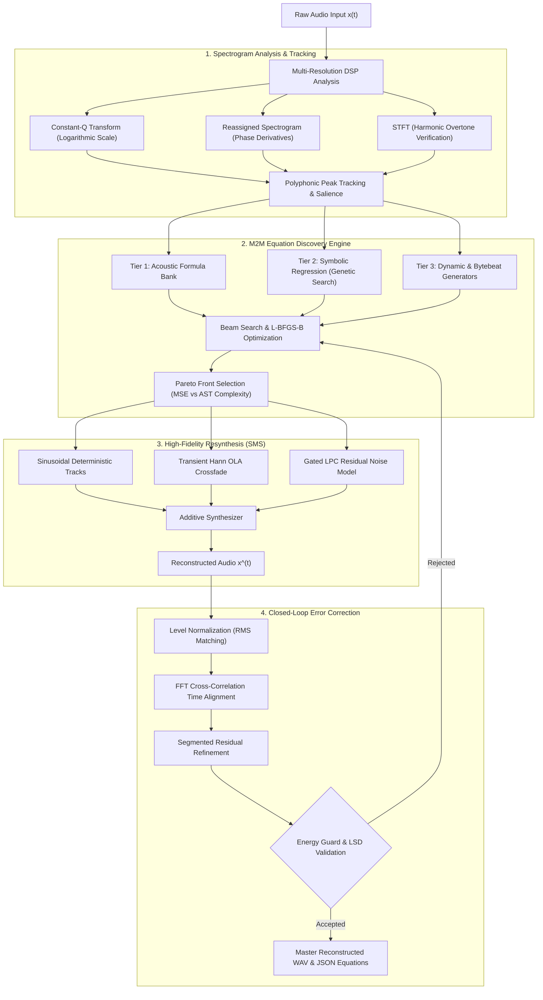
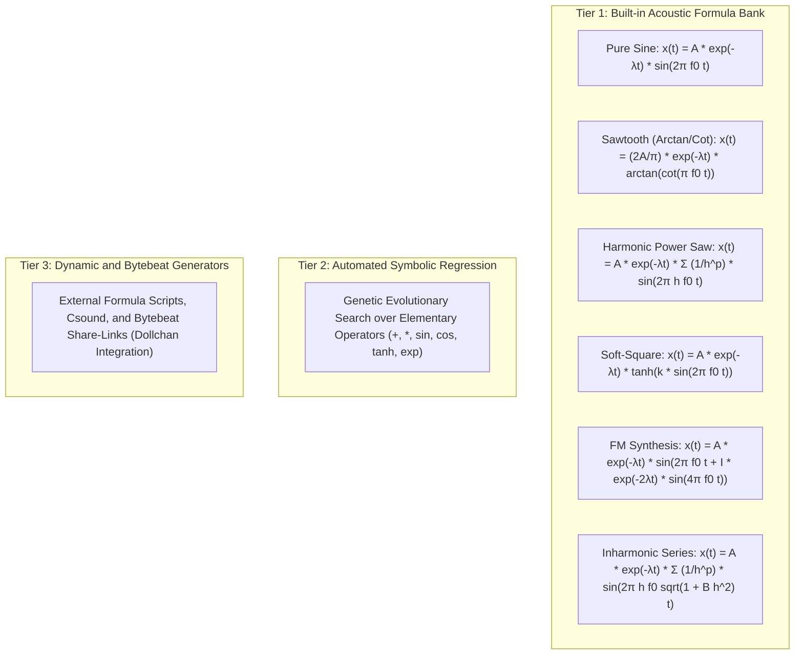
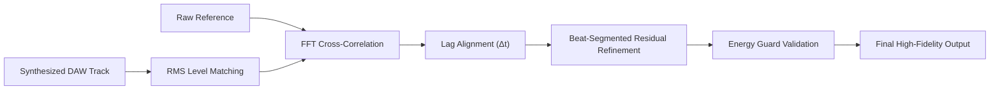

# M2M (RES): Mathematical Audio Reverse Engineering and Multi-Formula Studio

<p align="left">
  
  
  
  
  
  
</p>

> A mathematically rigorous digital signal processing (DSP) pipeline that reverse-engineers continuous instrumental and polyphonic audio files ($x(t)$) into compact analytical equations (JSON), reconstructing synthetic audio ($\hat{x}(t)$) using **Dictionary-Based Sparse Modeling**, **Constant-Q Spectrograms**, **Sinusoidal Modeling Synthesis (SMS)**, and an interactive **Multi-Track Equation DAW**.

---

## Table of Contents

- [System Pipeline Architecture](#system-pipeline-architecture)
- [Core Architecture and Engineering Principles](#core-architecture-and-engineering-principles)
  - [1. Spectrogram Mathematical Precision](#1-spectrogram-mathematical-precision)
  - [2. Polyphonic Peak Tracking vs Argmax Collapse](#2-polyphonic-peak-tracking-vs-argmax-collapse)
  - [3. 3-Tier Formula Architecture](#3-3-tier-formula-architecture)
- [Equation Discovery Engine](#equation-discovery-engine)
  - [Benchmark Partial Recovery Results](#benchmark-partial-recovery-results)
- [High-Fidelity Reconstruction: Sinusoidal Modeling Synthesis](#high-fidelity-reconstruction-sinusoidal-modeling-synthesis)
  - [Measured Benchmarks and Correction Values](#measured-benchmarks-and-correction-values)
  - [What Material Does This Reconstruct Best?](#what-material-does-this-reconstruct-best)
  - [Measured Limits (not projections)](#measured-limits-not-projections)
- [Closed-Loop Error Correction and Alignment](#closed-loop-error-correction-and-alignment)
  - [Multi-Stage Alignment Pipeline](#multi-stage-alignment-pipeline)
  - [Energy Guard and Objective Function Constraints](#energy-guard-and-objective-function-constraints)
- [Reverse Engineering and Synthesis (RES) Engine](#reverse-engineering-and-synthesis-res-engine)
- [Quickstart Guide](#quickstart-guide)
  - [1. Interactive Web Studio](#1-interactive-web-studio)
  - [2. Sample tests and provenance](#2-sample-tests-and-provenance)
  - [3. CLI Execution Examples](#3-cli-execution-examples)
  - [4. Running Unit Tests](#4-running-unit-tests)
- [Complete CLI Command Reference](#complete-cli-command-reference)
- [Project Directory Architecture](#project-directory-architecture)
- [License and Attribution](#license-and-attribution)

---

## System Pipeline Architecture

The M2M (RES) engine transforms unconstrained waveforms into closed-form mathematical equations and reconstructs the auditory experience through additive and stochastic resynthesis:



---

## Core Architecture and Engineering Principles

### 1. Spectrogram Mathematical Precision

Standard audio analysis setups default to linear Short-Time Fourier Transforms (STFT), creating fundamental resolution mismatches across the human auditory spectrum:

- **Python + `librosa` Discovery Core:** 100% of the equation fitting, parameter optimization, and synthesis logic is implemented directly in code without black-box proprietary dependencies.
- **`librosa.cqt` (Constant-Q Transform):** Spaces frequency bins logarithmically matching the Western musical scale (12 or 36 bins per octave). Low octaves receive dense frequency resolution to isolate fundamental bass notes, while upper octaves maintain high temporal precision.
- **`librosa.reassigned_spectrogram`:** Reassigns blurred energy centers using phase derivatives back to their exact instantaneous frequency and temporal coordinates, eliminating windowing smearing.
- **`librosa.stft` (Short-Time Fourier Transform):** Spaced linearly (5.38 Hz per bin). Used specifically to verify high-frequency overtone structures once fundamental frequencies are identified.

### 2. Polyphonic Peak Tracking vs Argmax Collapse

Many naive transcription pipelines apply global peak collapsing:

```python
pitches, magnitudes = librosa.piptrack(...)
idx = magnitudes.argmax(axis=0)  # Destroys polyphony
```

Collapsing across `axis=0` forces the spectrum into a single dominant frequency bin per frame, discarding concurrent harmonic layers, chords, and basslines. M2M (RES) resolves this via **per-frame multi-peak tracking** using `scipy.signal.find_peaks` across logarithmically spaced semitone bins, ensuring complete polyphonic retention.

### 3. 3-Tier Formula Architecture

Instead of allocating dozens of pure sine oscillators to reconstruct harmonic overtones (which leads to equation bloat), M2M uses a compact acoustic dictionary hierarchy:



---

## Equation Discovery Engine

Audio inverse problems are ill-posed: multiple parameter combinations can produce identical spectral projections. M2M (RES) models synthesis inversion as a multi-objective optimization problem:

1. **Beam Search over Formula Bank:** Parameter spaces `(decay_lambda, timbre_param)` are explored across multiple random seeds using L-BFGS-B bound optimization. Amplitude acts as a global linear scale and is solved via projection.
2. **Abstract Syntax Tree (AST) Complexity Scoring:** Complexity is measured via weighted AST operations (transcendental functions, powers, additions) rather than raw string length.
3. **Pareto Optimization:** Non-dominated solutions along the `(spectral_mse, complexity)` boundary are preserved.
4. **Complexity-Aware Selection:** The simplest equation within 2% of the optimal spectral error boundary is automatically selected, preventing overfitting without sacrificing fidelity.
5. **Recursive Library Learning (InceptionSR):** Individual partials are fitted iteratively against the time-domain residual and subtracted in an Orthogonal Matching Pursuit (OMP) fashion.

### Benchmark Partial Recovery Results

Evaluated on a synthetic triad benchmark with known analytical parameters:

| Partial | Detected Parameters | Ground Truth | Absolute Frequency Error |
|---|---|---|---|
| A4 | 439.9993 Hz, A=0.4850, λ=1.0982 | 440.0000 Hz, A=0.4987, λ=1.1000 | < 0.001 Hz |
| C#5 | 554.3639 Hz, A=0.2806, λ=1.4495 | 554.3650 Hz, A=0.2909, λ=1.4500 | < 0.002 Hz |
| E5 | 659.2550 Hz, A=0.1990, λ=1.7976 | 659.2550 Hz, A=0.2078, λ=1.8000 | < 0.001 Hz |

---

## High-Fidelity Reconstruction: Sinusoidal Modeling Synthesis

Classic Sinusoidal Modeling Synthesis (SMS) forms the foundation of the high-fidelity reconstruction module:

$$s(t) = \sum_{k} A_k(t) \cdot \sin(\theta_k(t)), \quad \theta_k(t) = \int_0^t 2\pi f_k(\tau) \, d\tau$$

Phase is integrated continuously over time rather than sampled as a static scalar, ensuring zero phase discontinuity across frame boundaries.

### Measured Benchmarks and Correction Values

| Test Signal | Signal-to-Noise Ratio (SNR) | Pearson Waveform Correlation ($\rho$) |
|---|---|---|
| Stationary Pure Tone (440 Hz, 1.0 s) | **102.2 dB** | **1.00000** |
| Decaying Benchmark Triad (Sinusoids Only) | **44.46 dB** | **0.99998** |
| Decaying Benchmark Triad (Sines + Noise) | **41.38 dB** | **0.99996** |

Key architectural insights derived from empirical testing:
- **Refined Constant Frequency vs Instantaneous Trajectories:** Instantaneous STFT peak picking introduces approximately 0.1 Hz of frame-to-frame jitter. Integrating noisy instantaneous frequency leads to large phase drift. Stationary partials benefit from refined fixed frequencies (yielding 44.7 dB vs 10.2 dB).
- **Least-Squares Amplitude and Phase Projection:** Windowing offsets are compensated via simultaneous two-column orthogonal projection.
- **Analytic Log-Linear Envelope Fitting:** Envelopes are fitted to internal frame decay ($A(t) = A_0 e^{-\lambda t}$) rather than raw boundary-distorted frame gains.

### What Material Does This Reconstruct Best?

Measured, not assumed. The engine is a sinusoidal model, so what it can express is
what it reconstructs well — and the correlation tracks the **tonal energy
fraction** of the input at **r = +0.935** across the frozen fixture set:

| fixture | harmonic energy | percussive energy | correlation | LSD |
|---|---|---|---|---|
| `stem_other` | 91.5 % | 2.2 % | 0.7376 | 9.50 |
| `stem_vocals` | 82.3 % | 3.6 % | 0.7535 | 9.11 |
| `mix_lost` (full mix) | 79.9 % | 8.6 % | **0.8518** | **3.61** |
| `stem_bass` | 51.8 % | 20.3 % | 0.6160 | 3.03 |
| `stem_drums` | 3.1 % | 83.5 % | **0.4107** | 18.04 |

Synthetic probes, same engine, known musical character:

| material | correlation | LSD | partials | wall-clock |
|---|---|---|---|---|
| Plucked string (harmonic decay) | **1.0000** | 0.35 | 23 | 13 s |
| Four-on-the-floor beat (modelled kick + hat) | 0.9963 | 2.01 | 102 | 16 s |
| Linear sweep | 0.8738 | 5.25 | 27 | 23 s |
| Sustained organ | 0.8590 | 3.93 | 40 | 23 s |
| Sustained chord pad | 0.8495 | 3.01 | 33 | 14 s |
| Gated bass only | 0.5852 | 3.83 | 78 | 9 s |
| **Vibrato tone** | **0.5196** | 12.54 | 942 | 91 s |
| Snare roll | 0.4690 | 21.97 | 515 | 65 s |
| White noise | 0.2342 | 29.52 | 821 | 150 s |

**Best material:** sustained or exponentially decaying *harmonic* content with
stable pitch — plucked strings, organs, pads, clean bass, and tonal percussion
(a kick modelled as a decaying sine). The literature agrees: sinusoidal models
are "unreasonably effective" for tonal sound and inefficient for noise and
sudden transients (Sethares & Smith; Verma, Levine & Meng's S+N+T model).

**The vibrato result is not a fluke.** Vibrato is *tonal*, yet it is the worst
tonal case, because the engine's evidence stage separates harmonic from
percussive content by median filtering the spectrogram, which assumes harmonic
content forms *horizontal* structures. Vibrato and glissandos break that
assumption (Park & Lee, ISMIR 2015), so a vibrato-heavy signal is split
incorrectly before modelling even starts.

**Beats:** beat-quantised sectioning helps, and now helps *without* the old
collapse, because the phase origin is re-referenced to the section:

| sectioning | correlation | LSD | SNR | partials | wall-clock |
|---|---|---|---|---|---|
| beat-quantised | **0.8518** | **3.61** | **5.61 dB** | 391 | 213 s |
| fixed window | 0.8379 | 3.91 | 5.23 dB | 345 | 198 s |

**For demos and the pitch deck, lead with sustained harmonic material** — a
clean bass line, a chord pad, a plucked motif. Use the drum-heavy material as
the *honest limit* case, where the engine reports 0.41 and LSD 18 dB, because
that contrast is the argument for the transient/noise model rather than a
liability.

---

### Measured Limits (not projections)

Every figure below is measured by `tools/bottleneck_scoreboard.py` on a frozen fixture set and recorded in `data/output/scoreboard.json`, with the exact command and the ledger path stored alongside it. See `docs/res_research.md` § Phase 7 for provenance.

- **Full mix, 10 s, 6 iterations:** `Metre - Lost.mp3` → **corr 0.8518, SNR 5.61 dB, LSD 3.61 dB**. Dense mastered material lands in the 0.80–0.86 band: multiband brickwall limiting, saturation and microsecond phase jitter are real limits on deterministic sinusoidal correlation.
- **Separated stems (native DSP partition of *j-hope - MONA LISA*, 10 s):** vocals **0.7535**, other **0.7376**, bass **0.6160**, drums **0.4107**. Tonal stems land in the 0.62–0.76 band.
- **Percussion is the hard case.** A drum stem reconstructs at **0.4107 correlation / LSD 18.04 dB**: a kick, a snare and a hi-hat are not sums of sinusoids, and even at 12 hits per section the percussive class can only afford 6 modes per hit. This is a modelling limit, not a renderer limit.
- **The renderer/analyser replica invariant is now enforced by test.** `tests/test_res_replica.py` compares the analyser's own output against the RES render of the *same* fitted parameters — the only comparison that can detect a replica gap, since the loop overwrites each section's recorded metric with the RES renderer's own score. `tests/test_res_phase_origin.py` pins the phase re-referencing law and the section-assignment rule.
- **Where the +0.8437 recovery came from, measured.** Reverting one file at a time to the release commit attributes it to the phase re-referencing in `src/res_evidence.py`, not to the acceptance gate. The class-C gate is worth **+0.0341** on the full mix and is **negative (−0.0087) on the drum stem**; the remaining **+0.8095** is the phase-origin fix. The `baseline_head` and `bisected_d2` labels exist so both claims stay checkable.

---

## Closed-Loop Error Correction and Alignment



### Multi-Stage Alignment Pipeline

1. **RMS Level Matching:** Peak-normalized stems are level-matched against the reference before computing difference signals.
2. **FFT Cross-Correlation Lag Alignment:** Global temporal offsets (often 20 to 60 ms in real recordings) are aligned via circular cross-correlation.
3. **Segmented Residual Correction:** Residual passes are executed on single-beat window partitions where stationary decay assumptions hold true.

### Energy Guard and Objective Function Constraints

Optimizing raw SNR can result in pathological behavior: emitting pure silence scores 0 dB. The M2M `energy_guard()` enforces:

$$\text{RMS}_{\text{candidate}} \in [0.35 \times \text{RMS}_{\text{ref}}, \, 3.0 \times \text{RMS}_{\text{ref}}]$$

Any correction candidate that collapses signal energy or causes runaway gain is rejected.

---

## Reverse Engineering and Synthesis (RES) Engine

The RES loop (`src/res_loop.py`) incorporates Phase 5 stabilization:

- **Raised-Cosine Hann Overlap-Add (OLA):** Replaced hard-boundary slicing with continuous Hann crossfades, eliminating transient edge clicks on vocal plosives and pads.
- **Gated Linear Predictive Coding (LPC) Noise:** LPC noise modeling is strictly gated by Spectral Flatness Measure (SFM) and Zero-Crossing Rate (ZCR). Clean sub-bass bypasses LPC modeling entirely.
- **Dampened Clustered Frequency Refinement:** Joint least-squares frequency shifts are clamped to $\pm 2.0$ Hz with quadratic regularization, eliminating bass phasing and flanging artifacts.
- **Log-Spectral Distance (LSD) Referee Metric:** Balances time-domain correlation with spectral fidelity, prioritizing auditory timbre matching over microsecond phase jitter.

> **Which of these actually run.** The OLA seam smoother, the Hilbert phase alignment and the clustered joint refinement are all implemented and unit-tested, but the production render path does not call them (`render_ledger(..., ola=False)` at every production call site), so they contribute nothing to a shipped reconstruction. The LPC noise class is likewise opt-in: it is reached only with `--noise`, and its gate is calibrated on measurement rather than on the SFM threshold this list implies — whole-spectrum SFM is ~0 on real residuals and can never be the primary trigger, so the zero-crossing rate carries the gate. `docs/res_research.md` § Phase 7 records which claims are live and which are not.

---

## Quickstart Guide

> **New here?** See **[INSTALL.md](INSTALL.md)** — it covers what a CLI is, how to
> install (venv, `pip install -e .`, optional extras) and how to run the app
> and the CLI. Everything there was verified from a clean virtualenv.

### 1. Interactive Web Studio

Launch the Streamlit interface:

```bash
.venv\Scripts\python.exe -m streamlit run app.py
```

Then open <http://localhost:8501>.

The app has two tabs, both of which are the product itself rather than a toolbox:

- **RES: Song → Equations → Replay** — upload any audio file, run the iterative equation synthesis loop, and compare Original vs Recreated vs Residual. The right-hand panel streams the run stage by stage (prepare → evidence → loop → package) with live correlation, SNR and LSD, so a multi-minute run is never a black box. The per-section equations are browsable in a dropdown, and the whole song plays back in the page.
- **Benchmarks: sample tests** — the frozen-fixture harness (§ *Sample tests and provenance* below). Press **Run sample test** to start a label in the background; the recorded labels, their correlations and the verification verdict are all rendered in the page.

### 2. Sample tests and provenance

A **label** is one named run of the engine over the frozen fixture set; a **row** is one fixture inside it. Both live in `data/output/scoreboard.json` next to the ledger that produced them, so every published number is a pointer to a file rather than a claim.

Run the harness from the browser (**Benchmarks** tab), or from the command line:

```bash
.venv\Scripts\python.exe tools\bottleneck_scoreboard.py --label after
.venv\Scripts\python.exe tools\verify_scoreboard.py
```

The verifier returns two verdicts that are deliberately not conflated:

| verdict | meaning |
|---|---|
| **consistent** | the row's numbers agree with the ledger it names (catches a stale ledger match under the same label) |
| **improved** | the run beat its own initial render: `best >= initial_correlation`, and `best` is exactly the best accepted iteration |

The second is the load-bearing one. A baseline whose gate could never fire records `best` *below* `initial` and matches no iteration at all — consistent with its own ledger, yet a shipped regression. A label may declare itself a captured regression via `expect_improvement` in `scoreboard.json`, so the baseline is reported without failing the tool, while **any other label that stops improving fails it**.

Four labels ship, and all four are re-runnable from the tree:

| label | provenance | mix_lost |
|---|---|---|
| `baseline_head` | the release commit re-run in-tree | 0.008146 |
| `bisected_d2` | the current tree minus the class-C gate hunk | 0.817686 |
| `after` | the current tree | 0.851825 |
| `baseline` | the older captured baseline, kept for reference | 0.008146 |

> **What the fix actually was.** The release's score collapsed because the SMS
> analyser projects every partial against its *analysis window's* time axis
> while the RES renderer draws it on the *section's* axis. When those origins
> disagree, every partial is rotated by `2*pi*f*(origin difference)` — hundreds
> of full cycles — so the reconstruction was uncorrelated even though every
> partial was individually correct. `src/res_evidence.py::_rephase_to_section`
> re-references the phase once, at build time.
>
> That is the whole of the +0.8437 recovery. The class-C acceptance gate
> accounts for **+0.0341** of it (and is **negative** on `stem_drums`), so the
> gate was never the main problem.

### 3. CLI Execution Examples

Execute the RES synthesis loop on an audio file:

```bash
python main.py res -i input_track.wav -o data/output/res_run --duration 15.0 --iterations 3
```

Reconstruct a track into Multi-Track Math-DAW equations:

```bash
python main.py recreate-song -i input_track.wav -o data/output/recreation --duration 16.0
```

Fit the optimal mathematical formula from the acoustic bank:

```bash
python main.py fit-formula -i segment.wav -o data/output/fitted_segment.wav
```

Discover competing equations and Pareto trade-offs:

```bash
python main.py discover-equations -i audio.wav -o data/output/equations.json
```

Synthesize audio directly from an equation JSON project:

```bash
python main.py synthesize -i equations.json -o data/output/rendered.wav
```

### 4. Running Unit Tests

Run the complete automated test suite (covering analysis, synthesis, formula banks, and tracking):

```bash
pytest tests/ -v
```

Or using Python's standard unittest runner:

```bash
python -m unittest discover tests
```

---

## Complete CLI Command Reference

| Command | Description | Primary Inputs / Outputs |
|---|---|---|
| `python main.py res` | Iterative equation synthesis loop with Phase 5 DSP stabilization. Flags: `--noise` (stochastic residual model), `--spectral-lane` (magnitude-domain acceptance), `--k-hits` / `--k-notes` (per-section hypothesis caps; `--k-hits` defaults to 12), `--stems auto\|demucs\|<dir>` (stem-first mode) | Input audio -> Reconstructed audio, residual WAV, equation JSON |
| `python main.py res-recommend` | Extrapolates gain decay and computes optimal iteration budget | Input ledger JSON -> Recommendation metrics |
| `python main.py recreate-song` | Multi-track equation decomposition of full audio files | Input audio -> DAW project JSON and rendered WAV |
| `python main.py fit-formula` | Matches audio segments against `FORMULA_BANK` via L-BFGS-B | Input WAV -> Fitted audio WAV and parameter dictionary |
| `python main.py discover-equations` | Computes Pareto front of equations and AST complexity scores | Input audio -> Equation candidate JSON |
| `python main.py math-daw` | Renders equation project files to master WAV | Project JSON -> Rendered master WAV |
| `python main.py math-daw-demo` | Renders preset demo compositions | Output folder -> Preset audio files |
| `python main.py analyze` | Extracts sinusoidal frequency tracks from audio | Input WAV -> Equation JSON |
| `python main.py synthesize` | Reconstructs audio from mathematical equation definitions | Equation JSON -> Rendered audio WAV |
| `python main.py verify` | Computes MSE, SNR, Spectral MSE, and Log-Spectral Distance | Original WAV + Reconstructed WAV -> Metric report |
| `python main.py refine` | Performs closed-loop iterative residual minimization | Input WAV -> Corrected audio WAV |
| `python main.py extract-notes` | Extracts note events using probabilistic pYIN tracking | Input WAV -> Note event list JSON |
| `python main.py run-all` | Executes complete end-to-end benchmark and validation suite | System validation run |
| `python tools\bottleneck_scoreboard.py --label NAME` | Runs the frozen-fixture harness and records a label in the scoreboard | Fixture set -> `scoreboard.json` + ledgers |
| `python tools\verify_scoreboard.py` | Checks every scoreboard row against its ledger, and every label against its own initial render | `scoreboard.json` -> verdict |

---

## Project Directory Architecture

```text
├── app.py                      # Streamlit app: RES reverse-engineering studio + benchmark harness
├── main.py                     # Unified CLI entry point
├── requirements.txt            # Python dependencies (numpy, scipy, librosa, soundfile, matplotlib, streamlit)
├── LICENSE                     # MIT Open Source License
├── .gitignore                  # Git manifest excluding caches, output dumps, and media
├── src/
│   ├── formula_bank.py         # 3-Tier Formula Bank, L-BFGS-B optimizer, beam search, Pareto selection
│   ├── bytebeat_url.py         # Dollchan-compatible share-link encoder/decoder (zlib/base64)
│   ├── sinusoidal_model.py     # Sinusoidal Modeling Synthesis: phase-accurate high-fidelity reconstruction
│   ├── error_correction.py     # Level matching, lag alignment, residual + segmented correction
│   ├── toneprint.py            # Landmark fingerprinting + harmonic-sieve tone identification
│   ├── beat_detection.py       # Multi-band spectral-flux tempo and beat tracking
│   ├── tone_remake.py          # Tone-to-equation recreation, refinement, and bytebeat export
│   ├── spectrogram_math.py     # CQT, Reassigned Spectrogram, and polyphonic peak tracking
│   ├── song_recreation.py      # Automated song reverse engineering and recreation
│   ├── math_track_engine.py    # Math-DAW multi-track engine, continuous phase, and safe evaluation
│   ├── math_track_visualize.py # Waveform and spectrogram visualization for equation tracks
│   ├── safe_eval.py            # AST-whitelisted safe mathematical expression evaluator
│   ├── synthesis.py            # Phase-integrated additive synthesis
│   ├── analysis.py             # STFT with window normalization and parabolic peak interpolation
│   ├── tracking.py             # Sinusoidal track continuation and log-linear envelope fitting
│   ├── note_extraction.py      # pYIN melody extraction and harmonic grouping
│   ├── residual.py             # Quantitative error metrics (MSE, SNR, LSD) and projection refinement
│   ├── res_loop.py             # RES iterative equation synthesis loop
│   ├── res_bank.py             # RES formula dictionary and candidate scoring
│   ├── res_synthesis.py        # Hann OLA reconstruction and gated LPC noise synthesis
│   ├── res_ui.py               # Streamlit UI components and playback controls
│   ├── scoreboard.py           # Scoreboard format, row checks, label verification, harness runner
│   ├── viral_math_reels.py     # Mathematical video animation and waveform visualization
│   └── visualize.py            # Waveform, FFT spectrum, and comparison plotting utilities
├── tests/
│   ├── test_analysis.py        # STFT analysis and parabolic interpolation accuracy tests
│   ├── test_formula_bank.py    # Formula bank parameter fitting and optimization tests
│   ├── test_sinusoidal_model.py# SMS reconstruction accuracy vs analytical ground truth
│   ├── test_spectrogram_math.py# CQT and reassigned spectrogram mathematical verification
│   ├── test_math_track_engine.py# Multi-track engine, variable evaluation, and MIDI tests
│   ├── test_error_correction.py# Closed-loop alignment, level matching, and energy guard tests
│   ├── test_res_iterations.py  # RES iterative convergence and residual reduction tests
│   ├── test_res_phase_origin.py# Renderer/analyser replica invariant: the ledger's metric must describe the ledger's partials
│   ├── test_app_structure.py   # Streamlit UI structure validation tests
│   └── test_app_upload.py      # Streamlit upload pipeline verification tests
├── tools/
│   ├── res_bytebeat.py         # Bytebeat formula conversion and audio generation utility
│   ├── res_floatbeat.py        # Floatbeat synthesis and URL exporter
│   ├── bottleneck_scoreboard.py # Frozen-fixture scoreboard: every claim is a row with a command and a ledger path
│   ├── verify_scoreboard.py     # Verifies every scoreboard row against its ledger, and every label against its initial render
│   ├── make_fixtures.py        # Regenerates the frozen fixture set (real separated stems)
│   └── check_render_fidelity.py # Compares a saved ledger's metrics against a fresh render of its own partials
├── site/                       # Web-based Dollchan audio player and interactive demos
├── bytebeat-composer/          # Embedded Bytebeat composer and visualizer tool
├── docs/
│   ├── math_model.md           # Mathematical derivation and DSP equations reference
│   ├── res_pipeline.html       # Interactive RES pipeline diagram documentation
│   └── res_research.md         # Comprehensive research logs, benchmarks, and ablation studies
└── data/
    ├── input/                  # Benchmark audio files (math_chord.wav, math_melody.wav)
    ├── output/                 # Generated project outputs (preserves folder structure)
    └── uploads/                # Temporary web uploads directory (preserves folder structure)
```

---

## License and Attribution

This project is licensed under the **MIT License** - see the [LICENSE](LICENSE) file for complete details.

Developed by **Biswajit Sahoo** (KIIT Bhubaneswar). If you use this software or the M2M (RES) mathematical modeling pipeline in your research, please cite this repository:

```bibtex
@software{sahoo2026m2m,
  author = {Biswajit Sahoo},
  title = {M2M (RES): Mathematical Audio Reverse Engineering and Multi-Formula Studio},
  year = {2026},
  url = {https://github.com/Biswajit-Sahoo-13/Muisc2Math}
}
```
